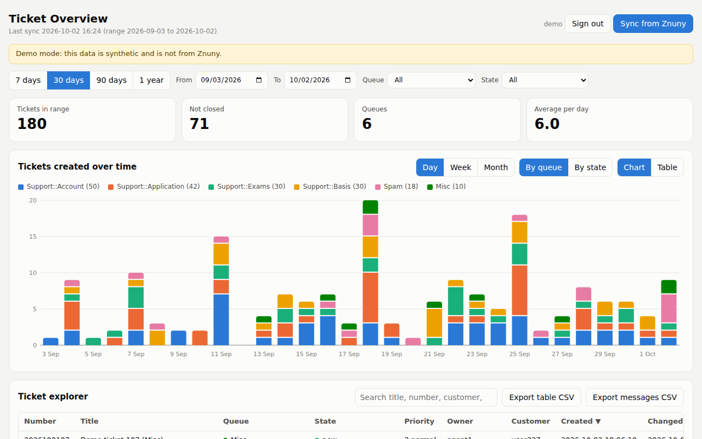
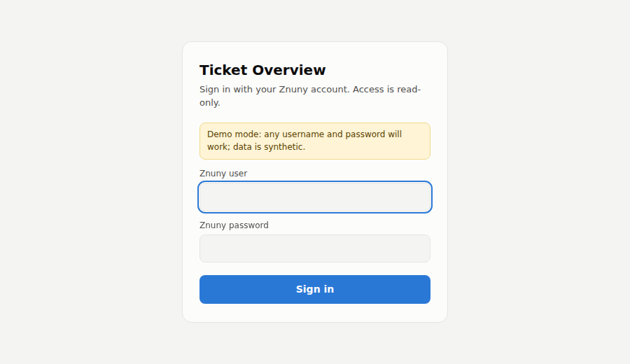
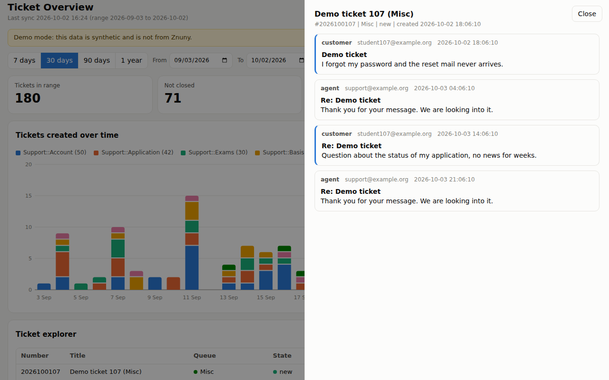

# Znuny Ticket Analyzer

A small, **read-only** web dashboard for exploring the tickets in a [Znuny](https://www.znuny.org/) / OTRS ticket system. It runs **locally on your own computer**, signs in with your own Znuny account, and shows:

- **Tickets created over time**: stacked bars by queue or by state, per day, week or month, with hover tooltips and a table view
- **Ticket explorer**: a searchable, sortable table of all tickets, with the text of the first customer message
- **Ticket detail**: click a ticket to read its complete message thread (all articles)
- **Exports**: the table, or all messages of the selected period, as CSV (handy for analysis)



| Login | Ticket detail |
|---|---|
|  |  |

*The screenshots use synthetic demo data, not real tickets.*

> **Unofficial project.** Znuny Ticket Analyzer is not affiliated with or endorsed by Znuny GmbH, OTRS AG or any university or organisation. It only reads data; it never creates, changes, closes or deletes tickets.

---

## Contents

1. [What you need](#1-what-you-need)
2. [Quick start (demo, no Znuny needed)](#2-quick-start-demo-no-znuny-needed)
3. [Connect it to your Znuny](#3-connect-it-to-your-znuny)
4. [Using the dashboard](#4-using-the-dashboard)
5. [Configuration reference](#5-configuration-reference)
6. [Znuny side: what the web service must provide](#6-znuny-side-what-the-web-service-must-provide)
7. [Privacy and security](#7-privacy-and-security)
8. [Troubleshooting](#8-troubleshooting)
9. [How it works / project layout](#9-how-it-works--project-layout)
10. [Limitations](#10-limitations)
11. [License](#11-license)

---

## 1. What you need

- **Python 3.9 or newer.** Check with `python --version` (on macOS/Linux it may be `python3 --version`). Download from <https://www.python.org/downloads/> if needed. On Windows, tick *"Add Python to PATH"* during installation.
- **A Znuny/OTRS system** with the Generic Interface ticket web service enabled, and an **agent account** that can use it (details in [section 6](#6-znuny-side-what-the-web-service-must-provide)). You can try the app without this, see section 2.
- **Network access** to your Znuny server (VPN or internal network if it is not public).
- A modern web browser.

## 2. Quick start (demo, no Znuny needed)

This gets the app running with synthetic data so you can see what it does.

**Step 1: get the code**

```bash
git clone https://github.com/<your-user>/Znuny Ticket Analyzer.git
cd Znuny Ticket Analyzer
```

(No git? On GitHub click **Code → Download ZIP**, unzip it, and open a terminal in the unzipped folder.)

**Step 2: create a virtual environment and install the requirements**

macOS / Linux:

```bash
python3 -m venv .venv
source .venv/bin/activate
pip install -r requirements.txt
```

Windows (PowerShell):

```powershell
python -m venv .venv
.venv\Scripts\Activate.ps1
pip install -r requirements.txt
```

If PowerShell refuses to run the activation script, run
`Set-ExecutionPolicy -Scope CurrentUser RemoteSigned` once and try again. In the classic Command Prompt use `.venv\Scripts\activate.bat`.

**Step 3: create your `.env` file**

macOS / Linux: `cp .env.example .env`
Windows: `copy .env.example .env`

Open `.env` in a text editor and set `DEMO=1`.

**Step 4: start the app**

```bash
python app.py
```

Open <http://127.0.0.1:5000> in your browser. In demo mode **any** username and password work. Press **Sync from Znuny** to generate the demo tickets.

Stop the app with `Ctrl+C`. Next time, just activate the virtual environment again (the `activate` line from step 2) and run `python app.py`.

## 3. Connect it to your Znuny

1. Complete steps 1 and 2 above.
2. Copy `.env.example` to `.env` (step 3) and set **`ZNUNY_URL`** to your web service URL, and set `DEMO=0`:

   ```
   ZNUNY_URL=https://znuny.example.org/otrs/nph-genericinterface.pl/Webservice/YourWebServiceName
   DEMO=0
   ```

   The URL always has the form
   `https://<host>/otrs/nph-genericinterface.pl/Webservice/<WebServiceName>`.
   `<WebServiceName>` is the name of the Generic Interface web service in Znuny (Admin → Web Services). Ask your Znuny administrator if you do not know it.
3. Start the app: `python app.py`, then open <http://127.0.0.1:5000>.
4. On the login page, enter your **Znuny agent username and password**. The app checks them against your Znuny server. The login page shows which URL it connects to.
5. Choose a date range (start with **7 or 30 days**) and press **Sync from Znuny**. The first sync can take a while because tickets are fetched one at a time.

You can keep several `.env` files (for example a test system and a production system) and swap them. After changing `.env`, **restart the app**: it is only read at startup.

## 4. Using the dashboard

- **Sync from Znuny** downloads the tickets *created* in the selected date range from all queues and states and stores them in a local cache (`data/tickets.db`). Everything else (charts, filters, table) works on this cache, so browsing is fast and does not load your Znuny server. Sync again whenever you want fresh data; existing tickets are updated.
- **Date range**: the presets (7 days, 30 days, 90 days, 1 year) or the *From / To* fields. You can only look at what you have synced: sync a wide range first if you want to browse a wide range.
- **Queue and State filters** narrow everything on the page (tiles, chart, table).
- **Chart controls**: *Day / Week / Month*, *By queue / By state*, and *Chart / Table* (the table view shows exactly the numbers behind the bars). Hover over the chart for a per-period breakdown. Colours follow the queue or state itself, so a queue keeps its colour when you filter. The seven most common values get their own colour; the rest share a grey.
- **Ticket explorer**: click a column header to sort, use the search box (searches title, ticket number, customer, owner and the first message). Click a row to open the full conversation; press `Esc` or *Close* to return.
- **Exports**: *Export table CSV* saves the table as currently filtered. *Export messages CSV* saves every message (article) of the tickets in the selected date range, one row per message.
- **Sign out** removes your credentials from the app's memory.

## 5. Configuration reference

All settings are optional environment variables, normally placed in `.env`:

| Variable | Default | Meaning |
|---|---|---|
| `ZNUNY_URL` | *(none)* | **Required** unless `DEMO=1`. Generic Interface web service URL. |
| `DEMO` | `0` | `1` = synthetic data, no Znuny connection, any login works. |
| `FETCH_ARTICLES` | `1` | `0` = do not fetch messages (faster, but no message text and no article counts). |
| `MAX_TICKETS` | `5000` | Safety cap on tickets fetched in one sync. |
| `PORT` | `5000` | Local port of the web app. |

Usernames and passwords are **never** configured in files. They are typed on the login page.

## 6. Znuny side: what the web service must provide

Znuny Ticket Analyzer uses the Python library [`pyotrs`](https://pyotrs.readthedocs.io/), which expects the standard Znuny/OTRS *Generic Interface* REST routes. Your web service must expose these operations:

| Purpose | HTTP route (relative to the web service URL) |
|---|---|
| Log in (create a session / access token) | `POST /Session` |
| Search tickets | `GET /Ticket` |
| Get one ticket (with articles) | `GET /Ticket/:TicketID` |

Znuny ships a ready-made example web service configuration (`GenericTicketConnectorREST.yml`) that provides these routes; import it under *Admin → Web Services* and give it a name. Znuny Ticket Analyzer only ever calls *login*, *search* and *get*: nothing that modifies data.

The login agent account must be allowed to use the web service and will see exactly the queues and tickets its Znuny permissions allow. Znuny Ticket Analyzer sends your username and password once to log in (`UserLogin` / `Password`, an **agent** login, not a customer login) and then works with the session token Znuny returns.

Whether your Znuny accepts normal directory (e.g. LDAP) credentials on the API, or only dedicated API accounts, depends on how your administrators configured it. Browser single sign-on (SAML/Shibboleth) logins are **not** used by the API; if the API only accepts SSO, ask your administrators for an API-capable account.

## 7. Privacy and security

- **Everything stays on your machine.** The app talks only to your Znuny server. Nothing is sent to any third party.
- **Tickets contain personal data** (names, email addresses, message text). The local cache `data/tickets.db` and any CSV exports contain that data. Handle them according to your organisation's data-protection rules, do not share them, and delete `data/` when you no longer need it. Both `data/` and `.env` are in `.gitignore`, so git will not upload them. **Never commit real ticket data to a public repository.**
- **Credentials** are held only in the running app's memory for your session; they are not written to disk or put in the browser cookie. Restarting the app signs you out. The cache is cleared automatically when a *different* user signs in, so two accounts with different permissions never see each other's data.
- `pyotrs` may store the temporary Znuny **session token** (not the password) in a small file in your system's temp folder (for example `/tmp/.pyotrs_session_id`). It expires with the Znuny session.
- The web app listens on **`127.0.0.1` only** (your own computer). Do **not** change this to `0.0.0.0` or put the app on a shared server: it has no HTTPS and anyone who could open the page would be working with the logged-in user's access.
- Using your Znuny account this way is subject to your organisation's policies. You are responsible for having permission to read and export the data.

## 8. Troubleshooting

| Symptom | Likely cause and fix |
|---|---|
| Login page says **"ZNUNY_URL is not configured"** | No `.env` file, or it is in the wrong folder. It must sit next to `app.py`, be named exactly `.env` (not `.env.txt`), and the app must be **restarted** after creating it. |
| **"Could not reach Znuny (HTTPError)"** | Wrong host or web service name in `ZNUNY_URL` (an HTTP 404 means the web service name does not exist), or no network/VPN access to the server. Open the URL in a browser to check that the host answers. |
| **"Znuny login failed"** | The server was reached but rejected the username/password for this web service. Check the credentials; ask your admin whether API logins are enabled for your account. |
| Sync shows **"Sync failed: TicketSearch failed"** | The account may lack permission, or the web service lacks the `GET /Ticket` route. See section 6. |
| Sync is **slow** | Tickets are fetched one at a time with all messages. Use a smaller date range, or set `FETCH_ARTICLES=0` for a faster sync without messages. |
| Chart/table are **empty** | You have not synced yet, or the chosen date range lies outside what you synced. Press *Sync* with that range. |
| *First message* column shows an agent reply | Your Znuny labels incoming messages differently from `customer`. Open a ticket and check the sender labels, then adjust `_first_text` in `znuny.py`. |
| `python` not found / wrong version | Use `python3` instead, and make sure it is 3.9+. On Windows try `py -3`. |
| `Address already in use` | Another program uses port 5000. Set `PORT=5001` in `.env`. |
| PowerShell blocks `Activate.ps1` | `Set-ExecutionPolicy -Scope CurrentUser RemoteSigned`, or use `activate.bat` in Command Prompt. |

## 9. How it works / project layout

```
Znuny Ticket Analyzer/
├── app.py              Flask app: login, pages and JSON API
├── znuny.py            Read-only Znuny access via pyotrs (+ demo data generator)
├── store.py            Local SQLite cache (tickets and articles)
├── templates/
│   ├── login.html      Login page
│   └── dashboard.html  The dashboard (HTML, CSS and JS in one file, no build step)
├── docs/               Screenshots for this README
├── requirements.txt    Python dependencies
├── .env.example        Template for your .env
└── LICENSE
```

Flow: **Sync** → `znuny.py` runs a ticket search and fetches each ticket (with its articles) → `store.py` saves them to `data/tickets.db` → the browser loads the cache via `/api/tickets` and draws the charts and tables client-side. Charts are plain inline SVG; there are no external services, CDNs or fonts.

| Route | Purpose |
|---|---|
| `GET /login`, `POST /login`, `GET /logout` | Sign in / out |
| `GET /` | The dashboard |
| `GET /api/tickets` | All cached tickets |
| `GET /api/tickets/<id>/articles` | The messages of one ticket |
| `POST /api/sync?from=YYYY-MM-DD&to=YYYY-MM-DD` | Start a sync |
| `GET /api/status` | Sync progress |
| `GET /api/export/articles.csv` | All messages in a date range as CSV |

## 10. Limitations

- Read-only by design; it cannot answer, move or close tickets.
- Dates are selected by ticket **creation** date. The values are shown as Znuny returns them (server time).
- Syncs fetch tickets one by one, so very large ranges are slow. `MAX_TICKETS` caps a single sync.
- Browse only date ranges you have synced; the app does not fetch on demand.
- The cache is a single local file shared by whoever uses this copy of the app on your computer; it is cleared when another account logs in.
- Tested on Python 3.9+ with `pyotrs` 1.5. Not tested against every Znuny/OTRS version.

## 11. License

[MIT](LICENSE). Contributions and issues are welcome; please never attach real ticket data to issues.
